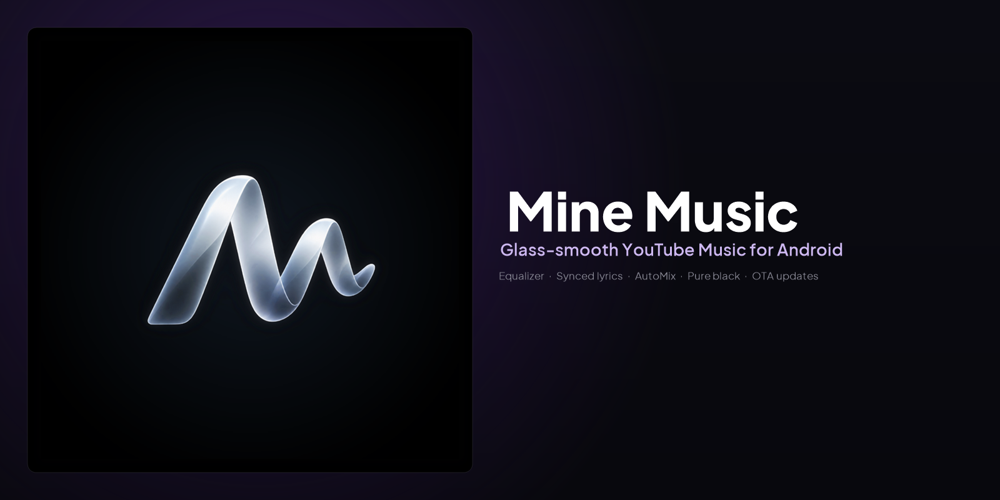
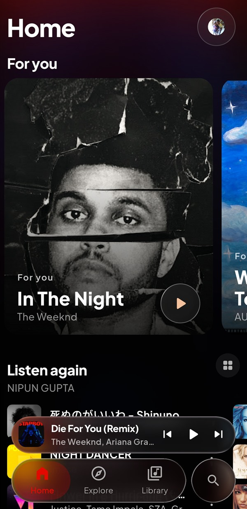
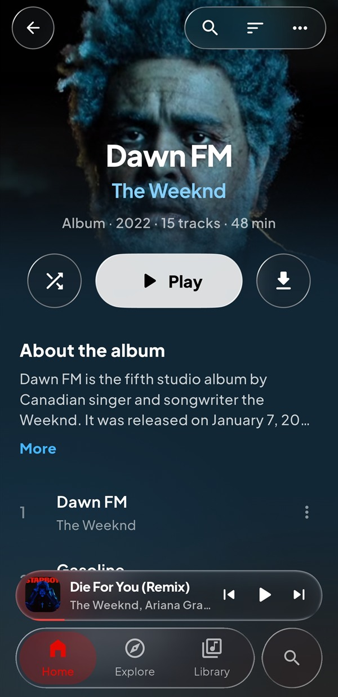
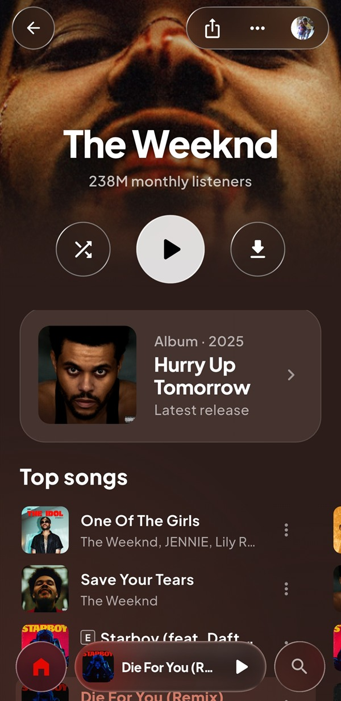
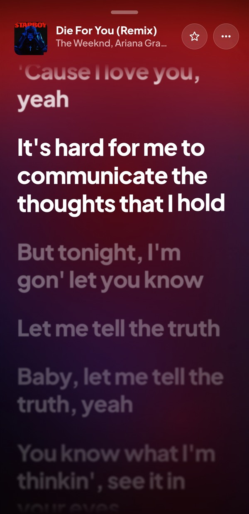
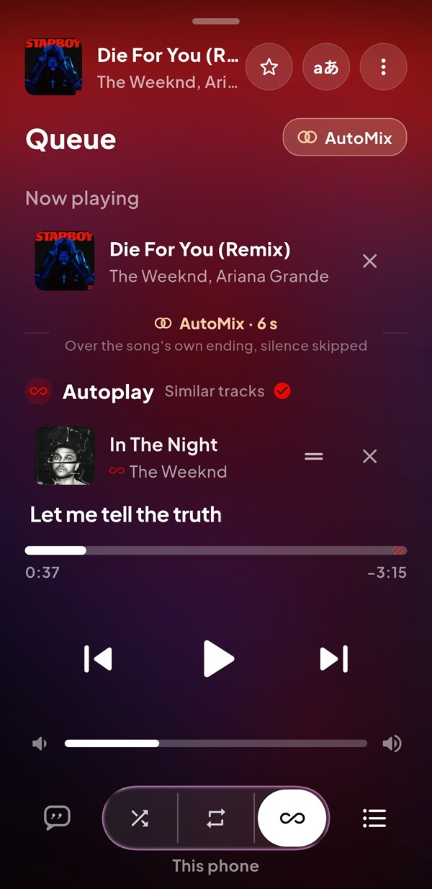
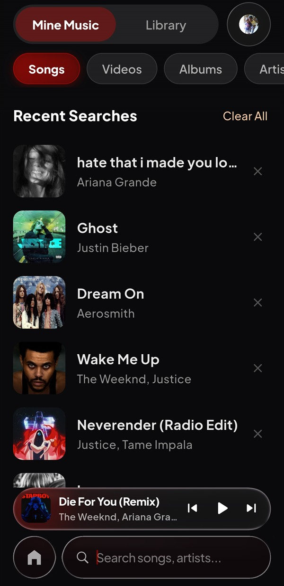

<div align="center">

<br/>
<br/>


# Mine Music

### Glass-smooth YouTube Music for Android

<br/>

[](https://flutter.dev)
[](https://dart.dev)
[](#)
[](LICENSE)
[](https://github.com/KESPREME/music_streaming_app/releases)

<br/>

[**Download**](#download) · [**Features**](#features) · [**Contributing**](CONTRIBUTING.md) · [**Code of Conduct**](CODE_OF_CONDUCT.md) · [**Disclaimer**](#disclaimer)

<br/>

</div>

> [!IMPORTANT]
> Mine Music is not affiliated with, endorsed by, or connected to YouTube or Google in any way. Use it at your own discretion.

---

<div align="center">



<h1><a id="features"></a>Features</h1>

<table>
  <tr>
    <td width="50%" valign="top">

#### Playback
- **Search, browse and play** anything on YouTube Music.
- **Gapless with real crossfade** — adjustable 0–12s.
- **AutoMix [Beta]** — DJ-style transitions, beat-matched + tempo-stretched.
- **Offline downloads** — save tracks with embedded metadata.
- **Local library** — your on-device music, alongside streaming.
- **Background playback** — foreground media session, lock-screen controls.
- **Equalizer** — system DSP (bass boost, virtualizer, loudness), per-output profiles, hold-to-compare, 23 presets + your own.
- **Queue + shuffle, repeat, sleep timer.**

#### Accounts
- **Sign in with Google** — your history, likes, and library.
- **Multi-account + channel profiles** — switch identities in one tap.
- **YouTube Music playlists** — read your YTM library; save a copy as an editable playlist.
- **Spotify import** — bring a playlist by link (no account needed).

</td>
    <td width="50%" valign="top">

#### Experience
- **Kinetic lyrics** — word/syllable sweep with feather + held-word swell, one RenderObject per line.
- **Providers race** — LrcRed, KuGou, Bini, LyricsPlus, Genius + more; word-synced wins, line-synced held briefly, plain last.
- **Animated album canvas** — looping video artwork, gated on Wi-Fi if you want.
- **Lady-tuned artwork pipeline** — baked blur wash (not live `ImageFiltered`), high-res upgrades only over unsigned URLs, per-row feather on scroll.
- **Pure black (AMOLED)** — optional true-black shell, bloom and blur skipped.
- **Liquid glass shell** — nav bar + mini player lens the content beneath; sections stay flat for 120 Hz scrolling.
- **Adaptive accent** — palette extracted from now-playing artwork.

#### Feel & motion
- **Jelly press** — every pill, circle and chip compresses under the finger and springs past rest on release (one haptic per touch, reduce-motion safe).
- **Docking player** — artwork flies between mini cover and full hero; scrim + translate only on the frame.
- **Per-network quality** — Wi-Fi vs cellular ceilings, auto or pinned.

</td>
  </tr>
</table>

</div>

---

<div align="center">

<h1><a id="download"></a>Download</h1>

<a href="https://github.com/KESPREME/music_streaming_app/releases" target="_blank" rel="noopener noreferrer"></a>

Grab the latest signed APK from [Releases](https://github.com/KESPREME/music_streaming_app/releases). Sideloading requires enabling “Install unknown apps” for the app you downloaded it with.

Every push to `main` that passes CI ships a signed release: APK + SHA-256 + `update.json` + banner + screenshots. The app checks at most every six hours, shows notes once per version, and verifies the download before handing it to the installer. See [`docs/RELEASING.md`](docs/RELEASING.md) for the release contract and signing setup.

</div>

---

<div align="center">

<h1><a id="screenshots"></a>Screens</h1>

| Home | Album | Artist |
|---|---|---|
|  |  |  |

| Kinetic lyrics | Queue &amp; AutoMix | Search |
|---|---|---|
|  |  |  |

More in [`release/images/`](release/images/) — the banner and the six screenshots shipped with each release and shown in the app’s Software Update screen.

</div>

---

## Architecture

```
InnerTube browseJson(FEmusic_home)          clientVersion dynamic, IP-inferred gl, visitorData cached
  ↓ staged walker (carousel + shelf + nested sectionList, continuation at sectionList)
HomeFeed { sections, heroCandidate, continuationToken }
  ↓ HomeComposer                            identity+title gate, section-local dedupe, artist cap
  ↓ HomeConvergence                         provenance:semantic:title, TTLs, omitted-but-valid retained
  ↓ HomeQualityGate                         ≥2 sections / ≥4 items, isDegraded vs high-water bestKnown
  ↓ HomeRepository                          SWR 45m, backoff 2h, coalesced, identity-scoped cache + memory
  ↓ MusicProvider                           homeFeed, quickPicks, search-followup graph
  ↓ HomeScreen                              _HomeBody → Selector → _LowerSections → planPresentation → widget
  ↓ planHomeShelves                         one shelf per job (no double “Listen again”)
  ↓ HomePlaybackController                  song/video/album/artist dispatch
```

`Quick Picks` rank deterministically (6 pools + skip/overexposure penalties, id tiebreak, never `Random()`). `SearchFollowupGraph` persists `query→track` with decay in `sqflite`.

### Key modules

```
lib/
  presentation/home/         classifySection, planPresentation, HomeTokens, HomeViewModeStore, HomeShelfPlan
  providers/                 music_provider (god-object, 3.8k lines), theme_provider, accent_controller
  services/home/             home_models, ytm_home_source, home_composer, home_convergence, home_diagnostics
  services/recommendation/   quick_picks_engine, search_followup_graph/store, section_engines, candidate
  services/lyrics/           lyric_clock, lyrics_service, provider_race, cache v3, translation
  services/eq/               eq_models, eq_curves, eq_presets, headroom, resampling
  services/playback/         decks (two AudioPlayers, one audio_service handler), transition engine
  services/update/           GitHub releases client, resume + SHA-256 verify, state machine
  services/session/          SessionStore (song, queue, pos, shuffle, tab, library filter)
  screens/                   home, library, search, equalizer, settings, software_update, details …
  widgets/                   lyric_line, eq, glass_surface/lens, covered_gate, blurred_backdrop, update/*
  design/tokens/             motion, space, type    design/glass/  chrome_glass
```

---

## Getting started

| Prereq | Version |
|---|---|
| Flutter | 3.47.1 |
| Dart | 3.13.1 |
| Android | target 36, min 24, NDK for audio DSP |
| JDK | 17 (Temurin) |

```bash
git clone https://github.com/KESPREME/music_streaming_app.git
cd music_streaming_app
flutter pub get
flutter run
```

Quality gates:

```bash
dart analyze            # 0 errors, ~179 infos (budget 190)
flutter test            # 812 tests
flutter build apk --debug
flutter build apk --release --build-name 1.1.0 --build-number 101
```

The project has strict invariants (no global cross-shelf dedupe, no artwork-based rejection, no `Random()` in ranking, no hardcoded fake sections, no `gl` override, etc.). Read [`CONTEXT.md`](CONTEXT.md) and [`CONTRIBUTING.md`](CONTRIBUTING.md) before changing the Home pipeline or lyrics engine.

---

## Tech stack

| Layer | Technology |
|---|---|
| Framework | Flutter 3.47 / Dart 3.13 |
| State | `provider` + immutable `PlaybackState` projection + `Selector` |
| Audio | `just_audio` 0.10 + `audio_service` (one handler over two decks, offload-safe) |
| InnerTube | Custom HTTP client, WEB_REMIX + PoToken web generator, dynamic browse `clientVersion` only |
| Glass | `liquid_glass_widgets` 1.8 + `liquid_glass_easy` (premium refraction on chrome only) |
| Images | `cached_network_image` with per-size `memCacheWidth`; `ImageQualityUtils` upgraded thumbs |
| Persistence | `sqflite` (lyrics cache v3, search followups), `flutter_secure_storage` (auth), `SharedPreferences` (prefs + section memory) |
| Fonts | Plus Jakarta Sans bundled in `assets/google_fonts/` via `AppFont` (no runtime fetch) |

---

<div align="center">

<h1><a id="contributing"></a>Contributing</h1>

We welcome contributions — start with [`CONTRIBUTING.md`](CONTRIBUTING.md) and [`CODE_OF_CONDUCT.md`](CODE_OF_CONDUCT.md).

[**Contributing Guide**](CONTRIBUTING.md) · [**Code of Conduct**](CODE_OF_CONDUCT.md)

</div>

---

<div align="center">

<h1><a id="disclaimer"></a>Disclaimer & legal notice</h1>

Mine Music is an independent, community-driven client. It is **not** associated with Google LLC, YouTube, YouTube Music, or any parent company.

* **No hosting:** It does not host, upload, or store copyrighted music files. It scans local storage or streams directly from public or user-authenticated APIs.
* **Personal use:** Built for personal research and fair-use purposes. You are responsible for complying with local copyright law and the YouTube Terms of Service.
* **Copyleft:** Free software under the GPLv3. Any distribution must ship the Corresponding Source under the same license.

</div>

---

<div align="center">

<h1><a id="license"></a>License</h1>

Licensed under the **GNU General Public License v3.0 (GPLv3)**. See [LICENSE](LICENSE).

</div>
